<div align="center">

# Doodle World

**A walkable 3D sketchbook. Every city is drawn in black ink on cream paper.**

Start in a small loft, walk out to the airport, and fly to Jiufen, the Bund or the San Francisco waterfront.
All of it is rendered live in the browser as hand-drawn line art.


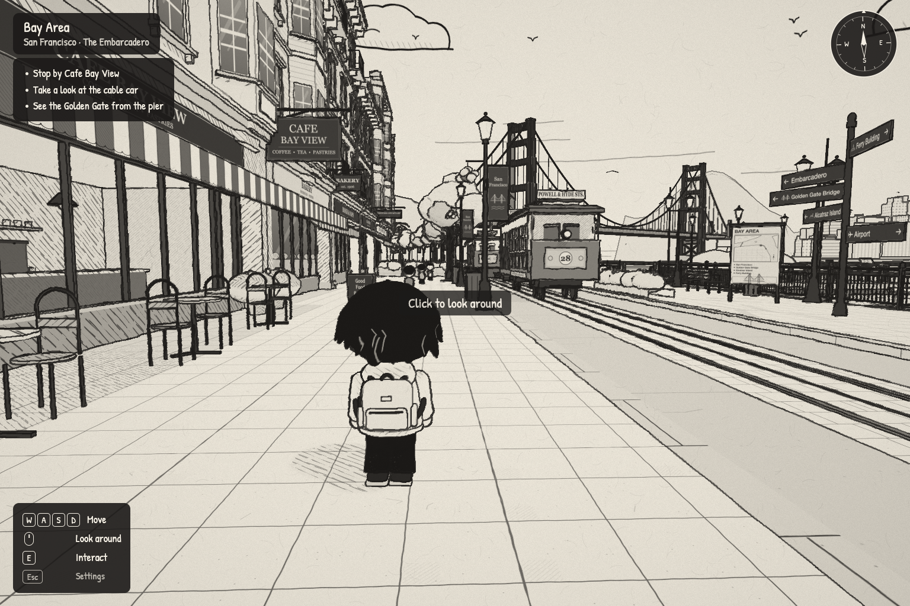

</div>

---

## Contents

- [Destinations](#destinations)
- [Features](#features)
- [Quick start](#quick-start)
- [Controls](#controls)
- [How it's drawn](#how-its-drawn)
- [Project structure](#project-structure)
- [Adding a city](#adding-a-city)
- [Testing](#testing)

## Destinations

Each city is one small, dense, walkable block, built from real landmarks and framed so the skyline is always in view.

<table>
  <tr>
    <td width="50%">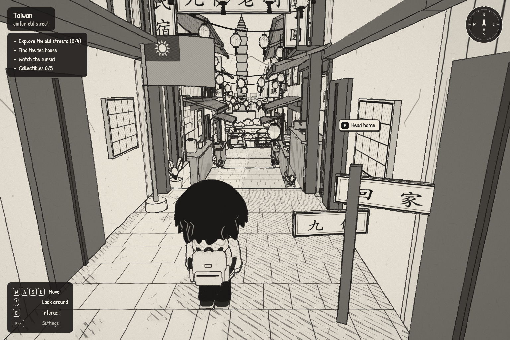</td>
    <td width="50%">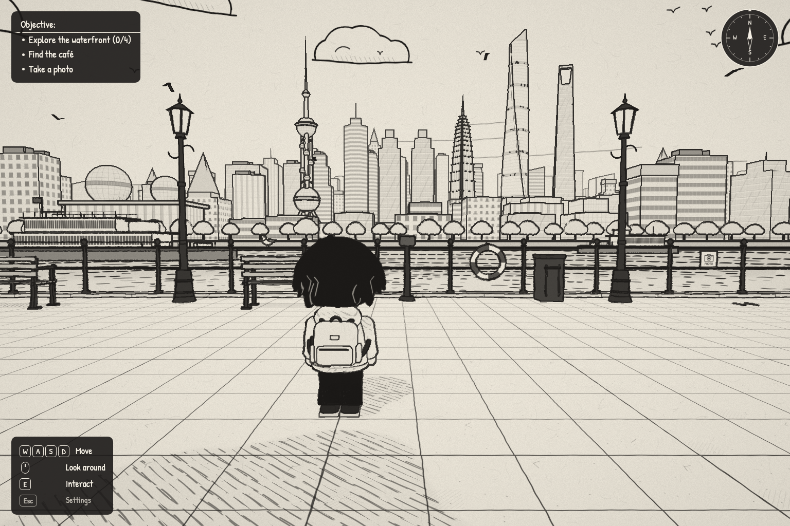</td>
  </tr>
  <tr>
    <td><b>Taiwan · Jiufen old street.</b> A stepped lantern-lit street with a tea house, food stalls, a cat and a lookout over the Taipei basin to Taipei 101.</td>
    <td><b>Shanghai · The Bund.</b> The riverside promenade with the old Bund behind you, and Pudong's skyline across the Huangpu River.</td>
  </tr>
  <tr>
    <td width="50%">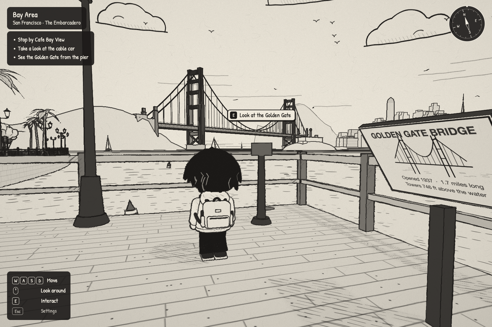</td>
    <td width="50%">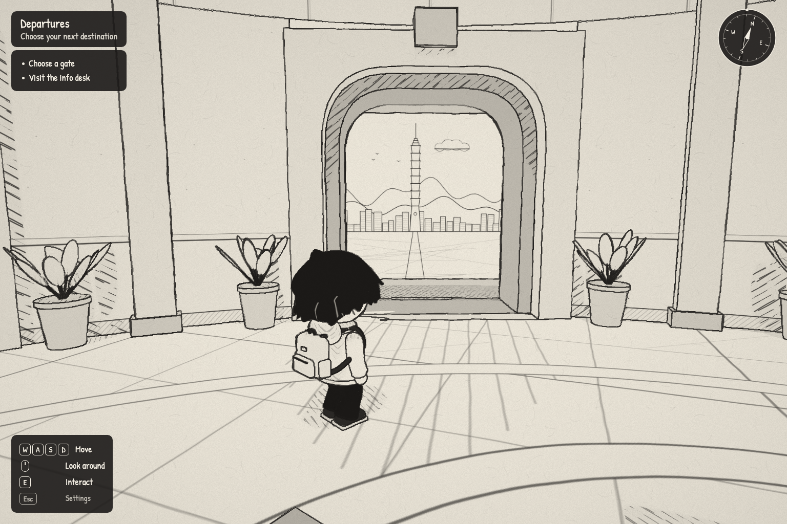</td>
  </tr>
  <tr>
    <td><b>San Francisco · The Embarcadero.</b> A café, a running cable car, and a fishing pier facing the Golden Gate Bridge across the bay.</td>
    <td><b>The airport.</b> A round departure hall where every city is a gate: walk up, check in, and board through the jetway.</td>
  </tr>
</table>

The journey begins at home, in the **doodle loft**, a furnished room with a desk, a kitchen and a hidden journal. The front door leads to the airport.

## Features

<table>
  <tr>
    <td width="33%">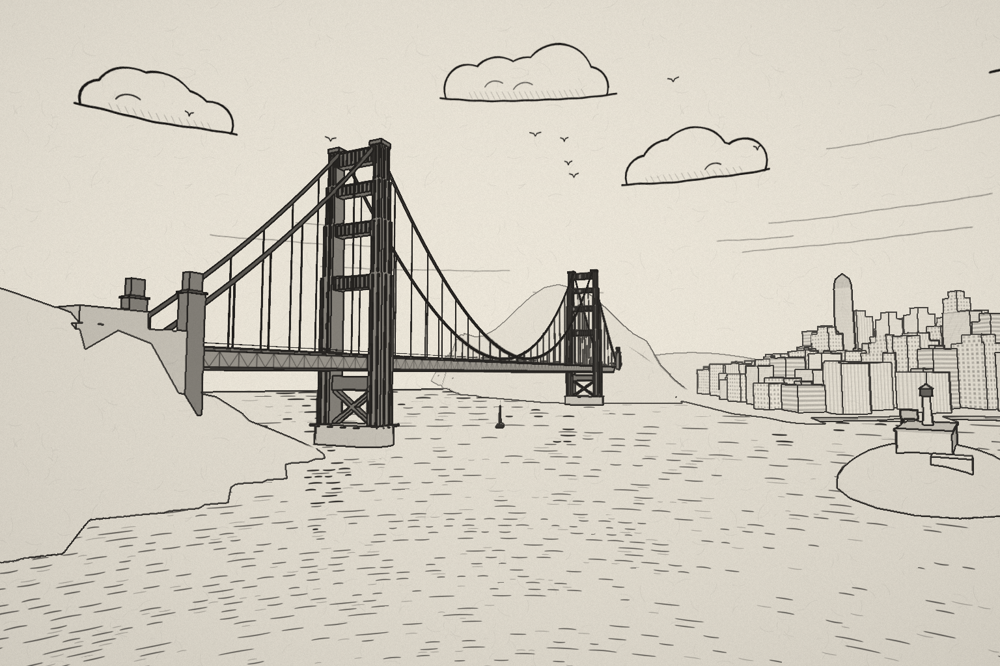</td>
    <td width="33%">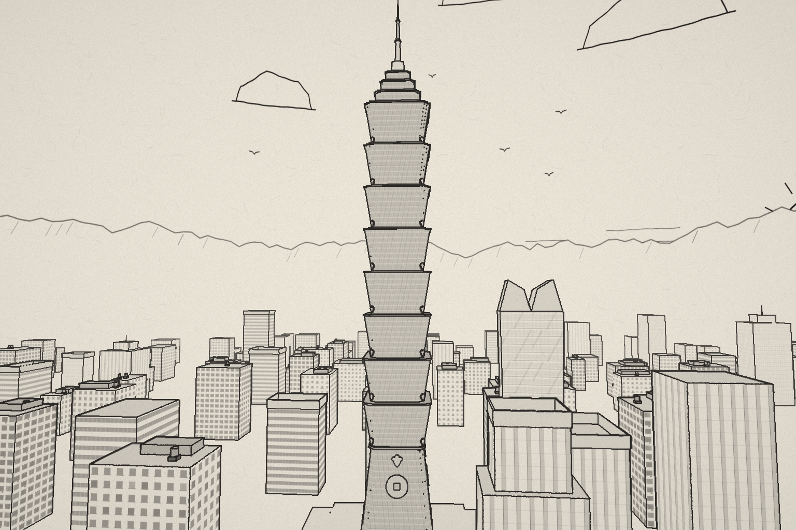</td>
    <td width="33%">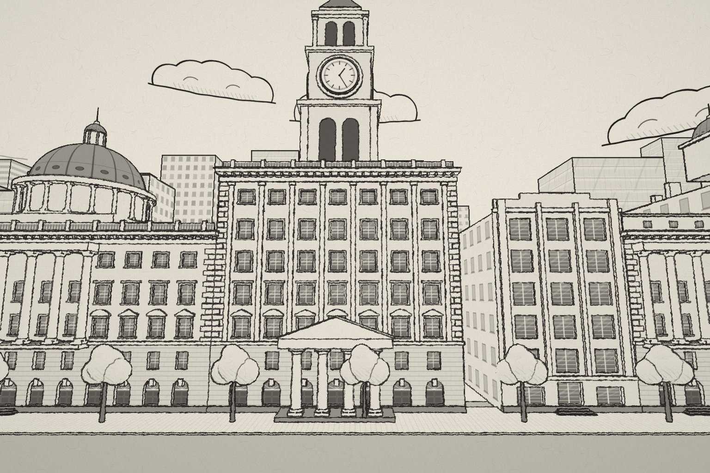</td>
  </tr>
  <tr>
    <td align="center"><sub>The Golden Gate: stepped towers, portal struts, a parabolic cable</sub></td>
    <td align="center"><sub>Taipei 101: eight flaring segments, the crown and spire</sub></td>
    <td align="center"><sub>The old Bund: the Customs House clock and the HSBC dome</sub></td>
  </tr>
</table>

- **Landmarks modelled from their structure.** These are 3D buildings, not painted backdrops. They include the Golden Gate Bridge (towers, cables, hangers, the truss deck), Taipei 101, the Oriental Pearl Tower, Jin Mao, the Shanghai World Financial Center, the Bund's facades, Coit Tower, the Salesforce Tower and the Transamerica Pyramid.
- **Things to do in every city.** Talk to the barista or the tea house auntie, sit on a bench and watch the boats, look through the pier's binoculars, take a photo, collect the hidden items, and follow the objective list.
- **A character from a reference sheet.** A chibi traveler with a hoodie and backpack, using inverse kinematics for the legs and hair and backpack that follow through on movement. They walk, turn, sit, lie down, reach and pick things up.
- **A photo album.** Snapshots become postcards and stay in an album for the session.
- **English and 中文.** Switch any time from the settings. Everything follows it: the HUD and dialogue, and every shop sign, street sign, menu and poster in the world, which redraw in place with wording written for each board.
- **Seamless travel.** Check in at a gate, walk down the jetway, and land in the city. Coming home puts you back in front of the gate you left from.
- **Self-contained.** Every texture, including the sky panoramas, is drawn with a wobbly-pen canvas helper when the page loads. Sound effects are synthesized. No image or audio files are shipped.

<table>
  <tr>
    <td width="33%">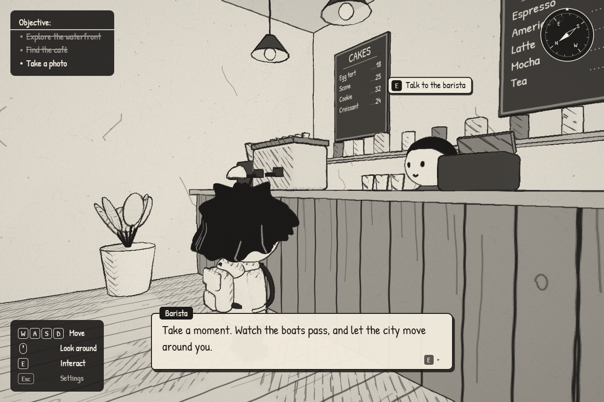</td>
    <td width="33%">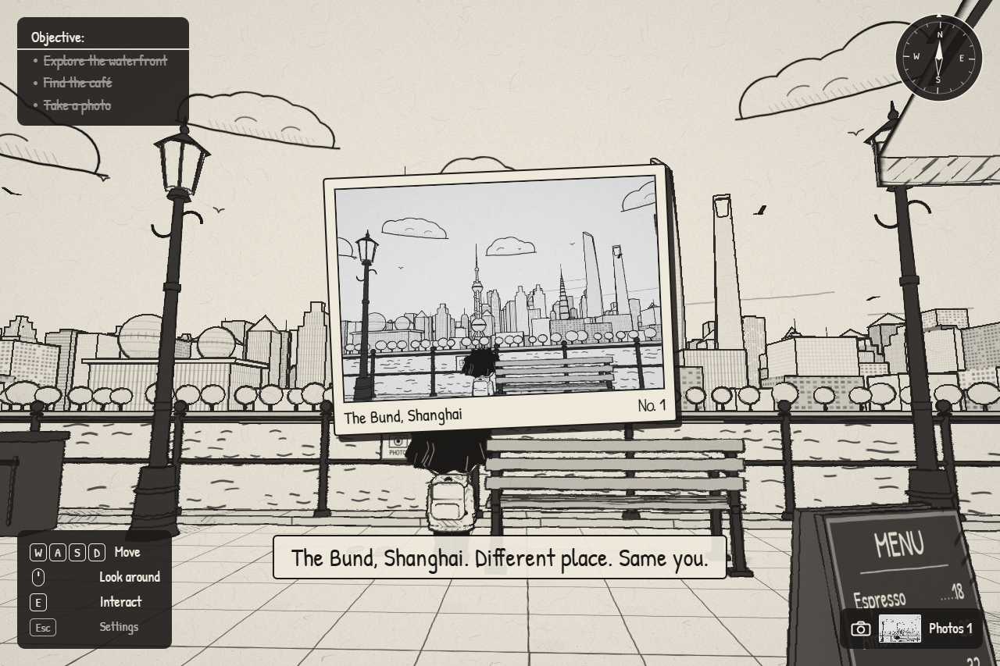</td>
    <td width="33%">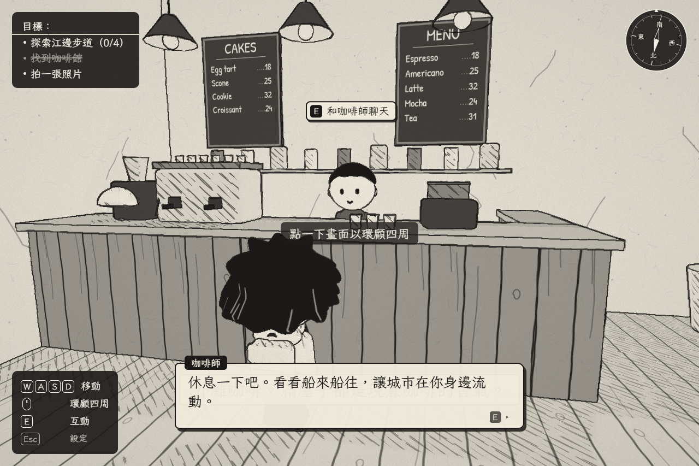</td>
  </tr>
  <tr>
    <td align="center"><sub>Dialogue at Bund Coffee</sub></td>
    <td align="center"><sub>Photos become postcards</sub></td>
    <td align="center"><sub>Fully playable in 中文</sub></td>
  </tr>
  <tr>
    <td width="33%">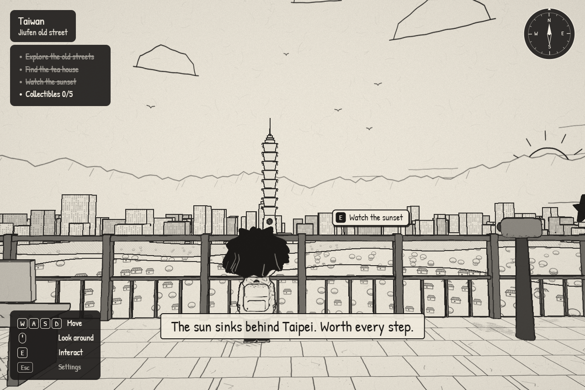</td>
    <td width="33%">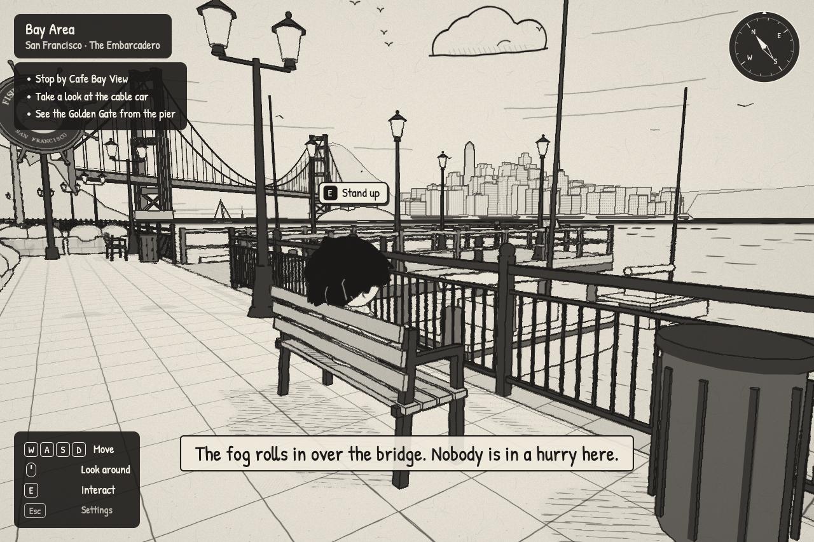</td>
    <td width="33%">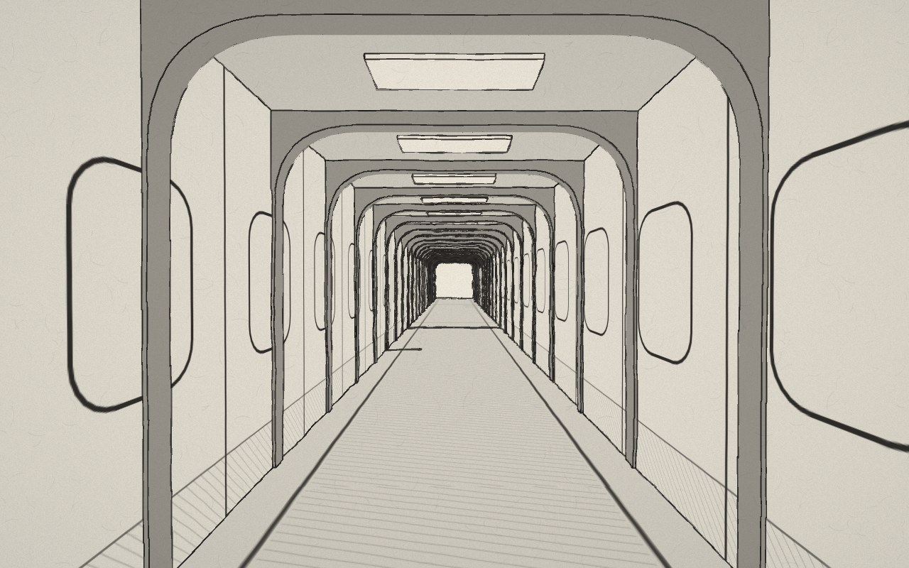</td>
  </tr>
  <tr>
    <td align="center"><sub>Watch the sunset over Taipei</sub></td>
    <td align="center"><sub>Sit and watch the bay</sub></td>
    <td align="center"><sub>Down the jetway to the next city</sub></td>
  </tr>
</table>

## Quick start

You need [Node.js](https://nodejs.org/) 20.19 or newer (Vite 8's minimum).

```bash
git clone https://github.com/evch1204/Doodle-Life.git
cd Doodle-Life
npm install
npm run dev
```

Then open **http://localhost:5173**. You start in the loft. To jump straight to a place, add a `scene` parameter:

| URL | Starts in |
| --- | --- |
| `/?scene=lobby` | The airport |
| `/?scene=taiwan` | Jiufen old street |
| `/?scene=shanghai` | The Bund |
| `/?scene=bayarea` | The Embarcadero |

For a production build, run `npm run build`, which writes to `dist/`. To serve that build locally, run `npm run preview`.

## Controls

| Key | Action |
| --- | --- |
| <kbd>W</kbd> <kbd>A</kbd> <kbd>S</kbd> <kbd>D</kbd> | Move |
| Mouse | Look around (click to capture the pointer, or drag) |
| <kbd>E</kbd> | Interact: talk, sit, check in, pick up |
| <kbd>Esc</kbd> | Settings (language, mouse sensitivity); also stands up from a seat or closes the journal |
| <kbd>Tab</kbd> | In the airport, reach the gates as buttons |

During a check-in, <kbd>E</kbd> or <kbd>Esc</kbd> skips the cutscene. With reduced motion turned on, travel becomes a simple fade. In each city, the 機場 / Airport signpost takes you back to the airport.

## How it's drawn

The ink look is a post-processing pass (`src/ink.js`) on top of a normal three.js render:

1. **Ink surfaces.** Each material is a flat paper tone. Faces turned away from the light, or in shadow, get one layer of hatching; faces that are both get crosshatching. The strokes are anchored in world space, so they don't swim as the camera moves.
2. **Outlines.** Every piece of geometry carries an *outline id*. The post pass draws a line wherever the id changes, wherever the surface normal creases sharply, and wherever the depth jumps. This gives clean contours with no extra geometry and no flicker.
3. **Aerial perspective.** Distant lines and tones fade toward the paper. Landmarks use a reserved *bold* id range, so they stay crisp at any distance.
4. **Paper.** A final pass adds the paper grain and a slight pen wobble.

Scenes are built with a small kit (`src/scenes/kit.js`) that merges geometry into one draw call per material, while each piece keeps its own outline id. The rivers and the bay use a water shader. Its ripple rows are spaced by viewing angle, and the reflections are drawn as pen strokes using the skyline's silhouette.

## Project structure

```
src/
├── main.js              entry point
├── game.js              renderer, ink pass, player controller, camera, collision, HUD, travel
├── ink.js               ink material and outline / paper post pass
├── character.js         the player and NPCs: chibi rig, leg IK, hair and backpack follow-through
├── i18n.js              English / 中文 string table
├── sketch.js            wobbly-pen canvas helper used by every texture
├── sound.js             synthesized sound effects
├── *Textures.js         per-scene textures, drawn when the page loads
└── scenes/
    ├── index.js         scene registry
    ├── kit.js           merged batches, placers, outline ids
    ├── room.js          the loft
    ├── lobby.js         the airport and its gates
    ├── taiwan.js        Jiufen   + taiwan/   (hillside town, Taipei 101 and the basin)
    ├── shanghai.js      the Bund + shanghai/ (Bund facades, Pudong, the river shader)
    └── bayarea.js       the Embarcadero + bayarea/ (street kit, cable car, bridge, SF terrain, props)
scripts/                 Playwright playtests, screenshot and performance tools
review/                  screenshots and playtest results from each milestone
```

Each scene module exports its layout: walkable ground (`heightAt`), colliders, interactables, objectives, start position and sun. The shared game in `game.js` handles everything else.

## Adding a city

A new city is one scene module, one line in `src/scenes/index.js`, and a gate in the airport. Gates are the `GATES` array at the top of `src/scenes/lobby.js`. The hall spaces them evenly round the back wall:

```js
{ id: 'tokyo', nameEn: 'Tokyo', nameZh: '東京', icon: 'globe', sceneArt: 'worldmap',
  route: 'tokyo', enabled: true },
```

- `route` is the scene id in `scenes/index.js`. Setting `enabled: false`, or leaving out the route, shows *Coming soon*.
- `icon` is a sign glyph (`ICONS` in `lobbyTextures.js`). `sceneArt` is the view through the arch (`ART` in `lobby.js`).
- Add the prompt (for example `'Check in to Tokyo'`) to `src/i18n.js`, and give the city a signpost home: `act: (ctx) => ctx.travel('lobby')`.

## Testing

The test scripts drive the game in headless Chrome through [Playwright](https://playwright.dev/). Start the dev server first. Each script reads the server address from `URL` (default `http://localhost:5173/`).

| Script | What it covers |
| --- | --- |
| `node scripts/playtest.mjs <dir>` | The loft: movement, collision, camera, every interaction |
| `node scripts/playtest_lobby.mjs <dir>` | The airport: every gate, skipping, coming-soon gates, the info desk, keyboard access, reduced motion |
| `node scripts/playtest_taiwan.mjs <dir>` | Jiufen: stairs, railings, camera orbits, objectives, collectibles, the trip there and back |
| `node scripts/playtest_shanghai.mjs <dir>` | The Bund: the river boundary along the whole railing, the café, interactions, animation |
| `node scripts/playtest_bayarea.mjs <dir>` | The Embarcadero: the cable car, the bay and pier boundaries, both ends, the lookout, benches |
| `node scripts/i18n_check.mjs [dir]` | Language switching, a Chinese entry for every reachable string, no text overflow |
| `node scripts/lettering_check.mjs [dir]` | Every sign, menu and poster in each scene follows the language; saves a sheet of them in each language |
| `SCENE=<id> node scripts/perf.mjs` | Frame times, mesh and triangle counts from three gameplay views |
| `node scripts/shots.mjs <dir>` | Review stills (set `SCENE=taiwan`, `shanghai` or `bayarea` for those views) |

`TIMEOUT_SCALE=3` stretches the walking timeouts on a slow machine. The scripts launch Chrome with `--use-angle=d3d11`, which uses the GPU on Windows. On macOS, use `--use-angle=metal` instead; otherwise Chrome renders on the CPU and the walking checks time out.

Screenshots and playtest results from every milestone are kept in [`review/`](review/).
