<div align="center">

# Doodle World

**A walkable 3D sketchbook. Every city is drawn in black ink on cream paper.**

Start in a small loft, walk out to the airport, and fly to Jiufen, the Bund or the San Francisco waterfront.
All of it is rendered live in the browser as hand-drawn line art.


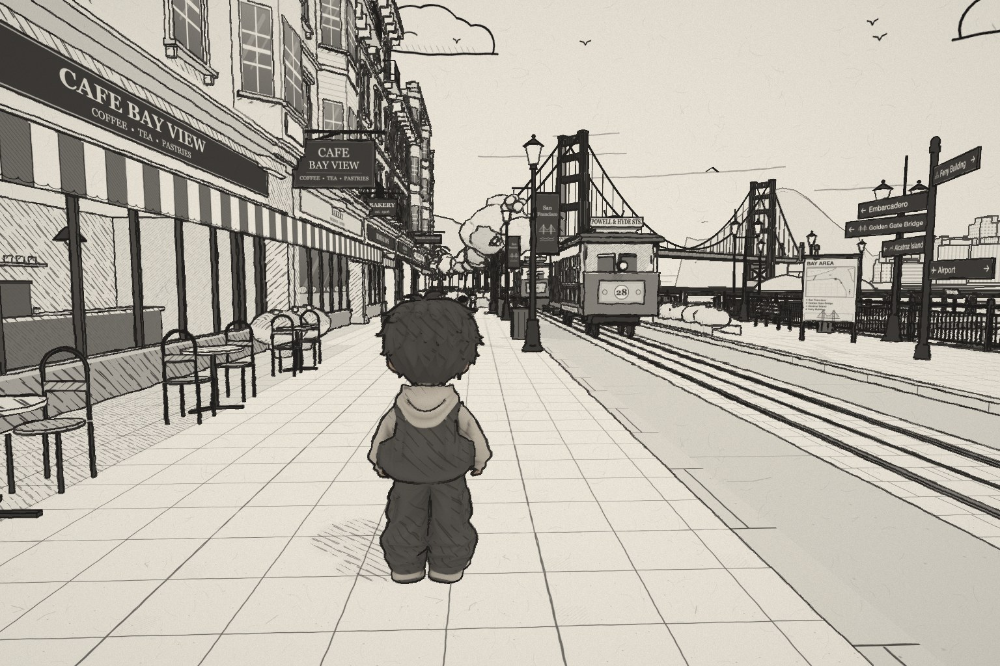

</div>

---

## Contents

- [Destinations](#destinations)
- [The traveler](#the-traveler)
- [Features](#features)
- [Quick start](#quick-start)
- [Controls](#controls)
- [How it's drawn](#how-its-drawn)
- [Project structure](#project-structure)
- [Adding a city](#adding-a-city)
- [Testing](#testing)

## Destinations

The journey begins at home and leaves through the airport. Each city is one small, dense, walkable block, built from real landmarks and framed so the skyline is always in view.

<table>
  <tr>
    <td width="50%">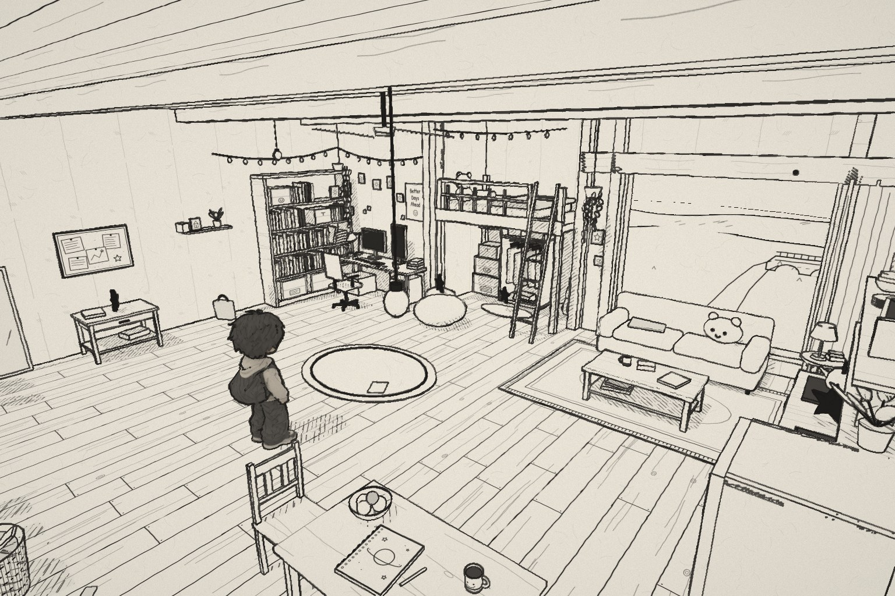</td>
    <td width="50%">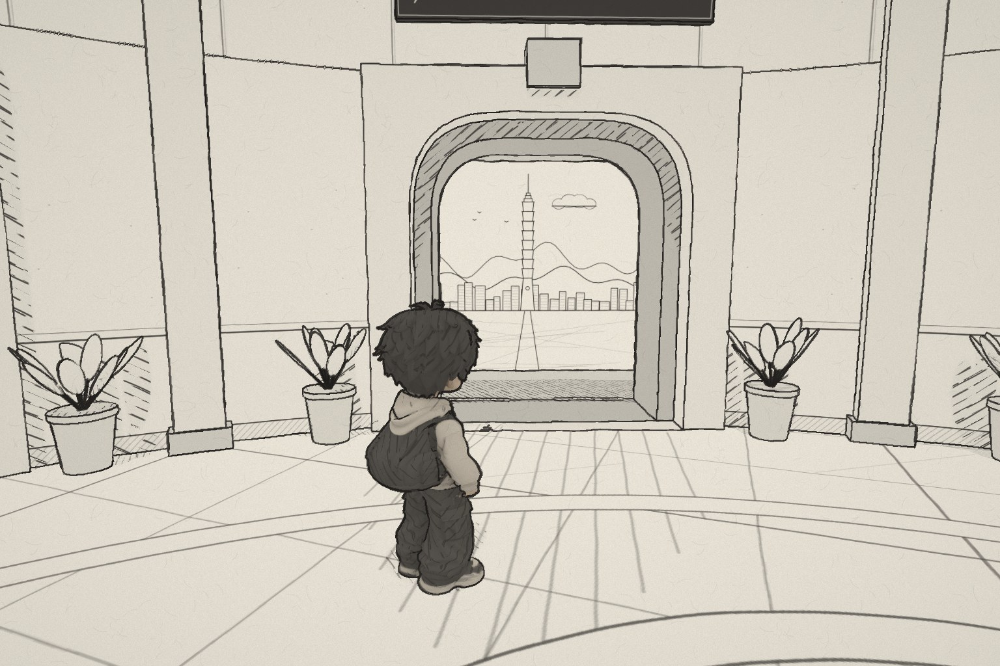</td>
  </tr>
  <tr>
    <td><b>The doodle loft.</b> Home: a desk, a kitchen, a loft bed, stars to collect and a hidden journal. The front door leads to the airport.</td>
    <td><b>The airport.</b> A round departure hall where every city is a gate: walk up, check in, and board through the jetway.</td>
  </tr>
</table>

<table>
  <tr>
    <td width="33%">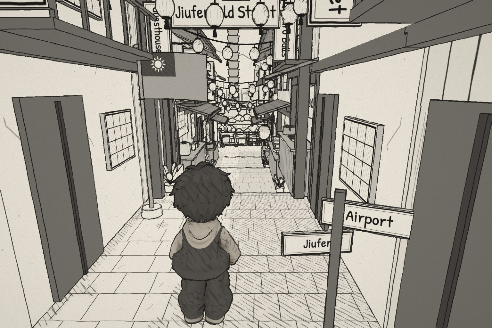</td>
    <td width="33%">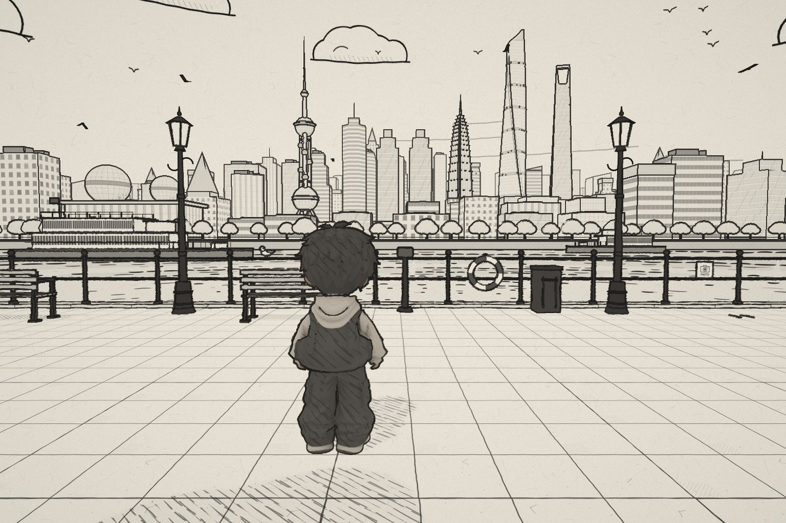</td>
    <td width="33%">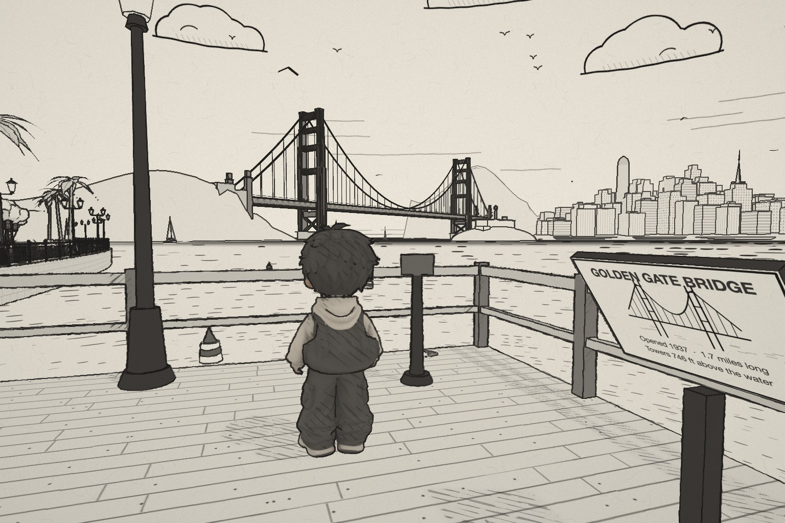</td>
  </tr>
  <tr>
    <td><b>Taiwan · Jiufen old street.</b> A stepped lantern-lit street with a tea house, food stalls, a cat and a lookout over the Taipei basin to Taipei 101.</td>
    <td><b>Shanghai · The Bund.</b> The riverside promenade with the old Bund behind you, and Pudong's skyline across the Huangpu River.</td>
    <td><b>San Francisco · The Embarcadero.</b> A café, a running cable car, and a fishing pier facing the Golden Gate Bridge across the bay.</td>
  </tr>
</table>

## The traveler

You play a chibi traveler in a hoodie and backpack. The character started as a drawn reference sheet and became a textured 3D model, shaded with the same ink as the rest of the world.

<table>
  <tr>
    <td width="50%">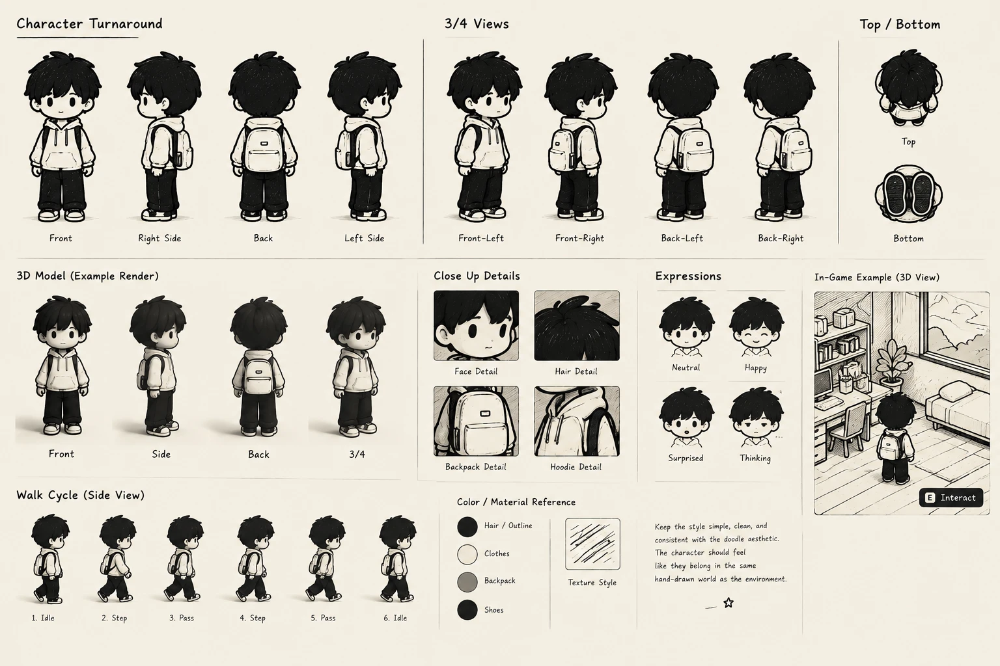</td>
    <td width="50%">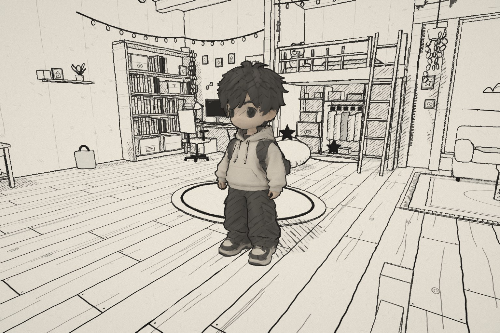</td>
  </tr>
  <tr>
    <td align="center"><sub>The reference sheet</sub></td>
    <td align="center"><sub>In the game</sub></td>
  </tr>
</table>

All of their motion is procedural, so they move with the world instead of playing back clips. The legs use inverse kinematics to land on steps, the hair and backpack follow through on movement, and furniture is used the way a small person would use it:

<table>
  <tr>
    <td width="33%">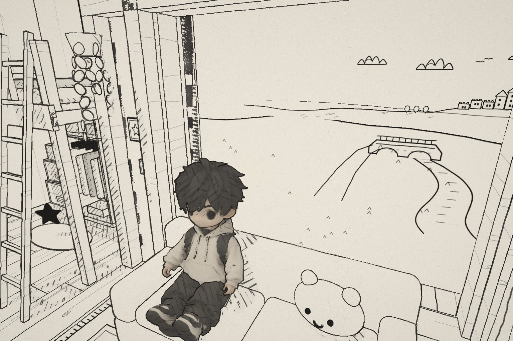</td>
    <td width="33%">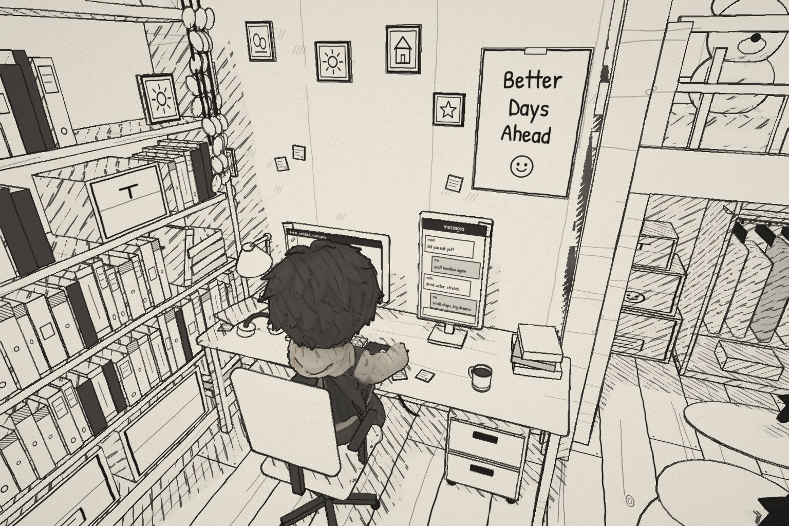</td>
    <td width="33%">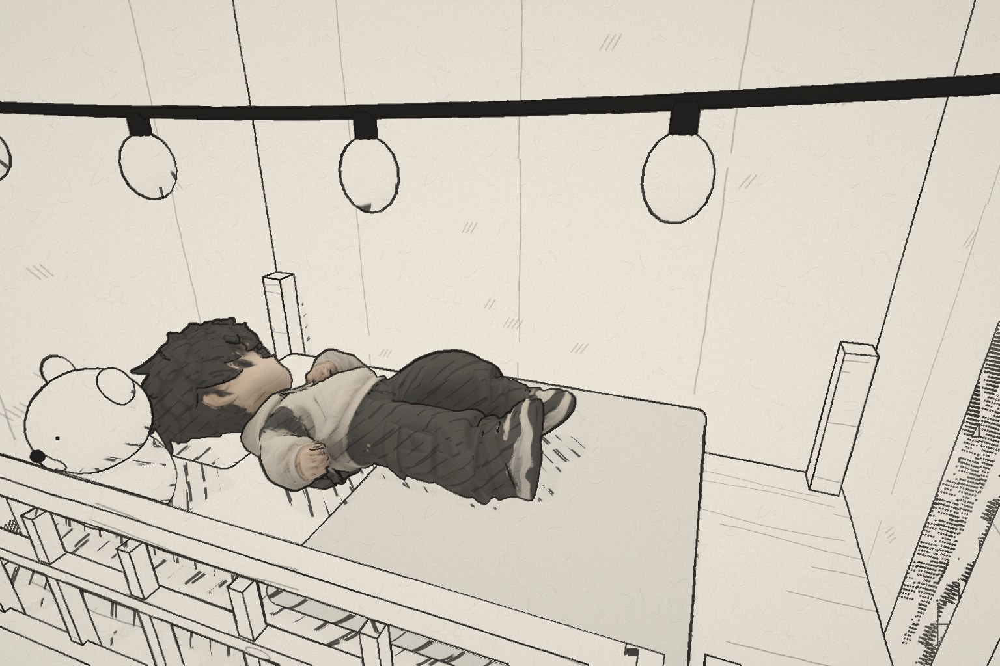</td>
  </tr>
  <tr>
    <td><b>Sit.</b> Turn around, put their hands back on the seat and hop up. Legs fit the seat: shins hang over a chair, calves lie over a bench edge, and legs stick out along the deep sofa.</td>
    <td><b>Work.</b> Roll the office chair in to the desk, left hand on the keyboard and right on the mouse, and type in short bursts. <kbd>E</kbd> types up the next screen.</td>
    <td><b>Sleep.</b> Climb the ladder rung by rung, sit on the end of the mattress, scoot up it and lie back. Asleep they breathe slowly. Getting up runs it all in reverse.</td>
  </tr>
</table>

### How the model is made

[Hunyuan3D 2.1](https://github.com/Tencent-Hunyuan/Hunyuan3D-2.1) generated the model from the reference sheet, and `tools/chibi/prep.py` turns that scan into `src/assets/chibi.glb`. The script runs in Blender and does five things:

- welds and decimates the mesh to 36k triangles
- bakes the scan's colours onto fresh UVs
- shortens the body to about 2.7 heads
- smooths the shading normals, so the outline pass doesn't draw the scan's small bumps
- rigs it for the procedural animation in `src/chibi.js`

In the game the model is shown at real-world size, about 1.5 m. Its colours are pulled onto the paper-and-ink palette, and its shadows are hatched like the rest of the world.

```bash
blender -b -P tools/chibi/prep.py -- --export src/assets/chibi.glb --render review/chibi-build
```

The source scan (`review/chibi-ref/hunyuan.glb`, 78 MB) stays out of git; keep a copy to rebuild the model.

## Features

<table>
  <tr>
    <td width="33%">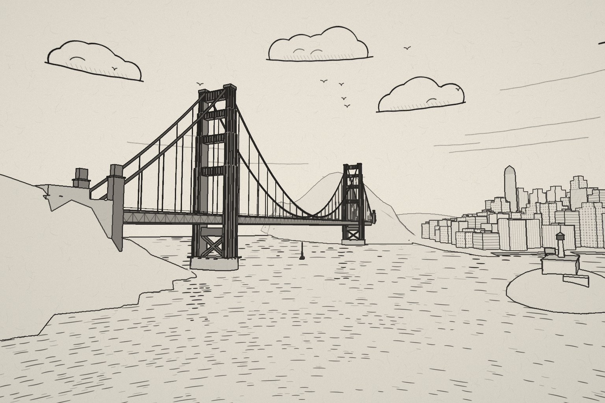</td>
    <td width="33%">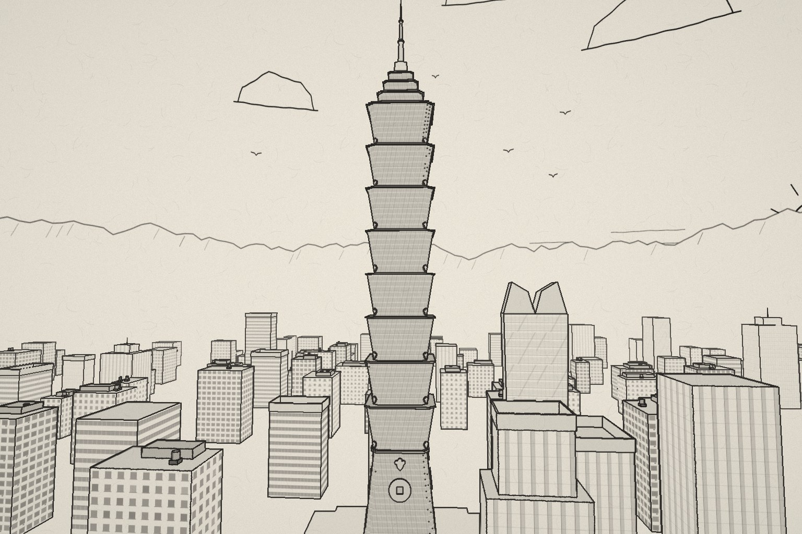</td>
    <td width="33%">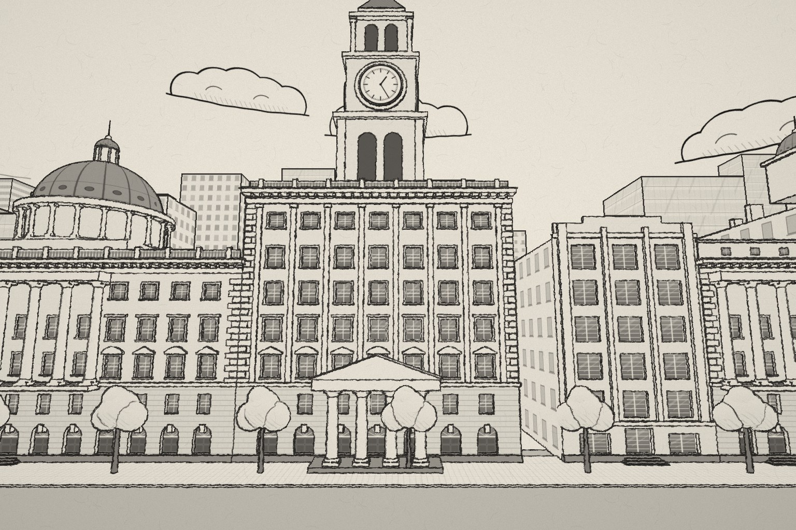</td>
  </tr>
  <tr>
    <td align="center"><sub>The Golden Gate: stepped towers, portal struts, a parabolic cable</sub></td>
    <td align="center"><sub>Taipei 101: eight flaring segments, the crown and spire</sub></td>
    <td align="center"><sub>The old Bund: the Customs House clock and the HSBC dome</sub></td>
  </tr>
</table>

- **Landmarks modelled from their structure.** These are 3D buildings, not painted backdrops. They include the Golden Gate Bridge (towers, cables, hangers, the truss deck), Taipei 101, the Oriental Pearl Tower, Jin Mao, the Shanghai World Financial Center, the Bund's facades, Coit Tower, the Salesforce Tower and the Transamerica Pyramid.
- **Things to do in every city.** Talk to the barista or the tea house auntie, sit on a bench and watch the boats, look through the pier's binoculars, take a photo, collect the hidden items, and follow the objective list.
- **A photo album.** Snapshots become postcards and stay in an album for the session.
- **English and 中文.** Switch any time from the settings. Everything follows it: the HUD and dialogue, and every shop sign, street sign, menu and poster in the world, which redraw in place with wording written for each board.
- **Seamless travel.** Check in at a gate, walk down the jetway, and land in the city. Coming home puts you back in front of the gate you left from.
- **Self-contained.** Every texture, including the sky panoramas, is drawn with a wobbly-pen canvas helper when the page loads, and sound effects are synthesized. No image or audio files are shipped; the only assets are the player model and the two handwriting fonts.

<table>
  <tr>
    <td width="33%">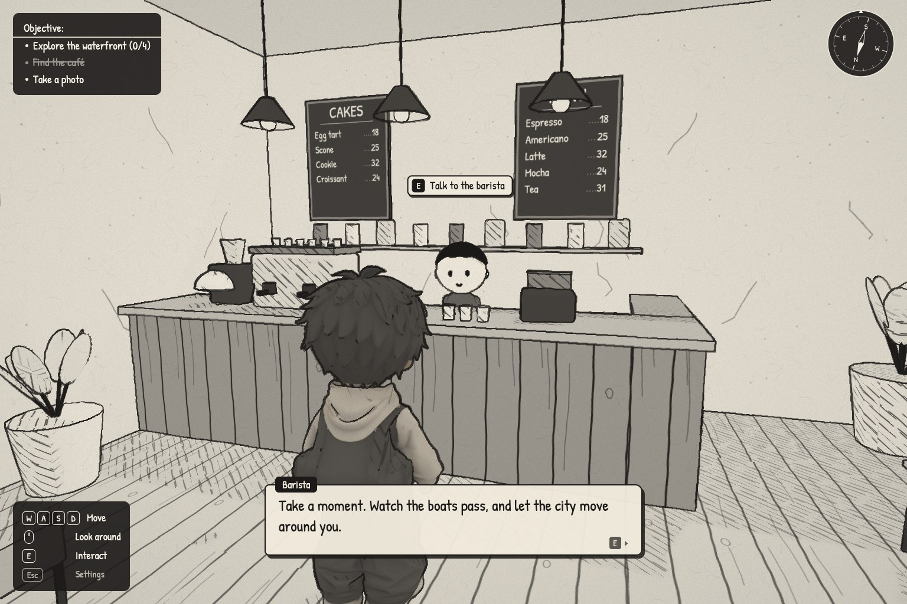</td>
    <td width="33%">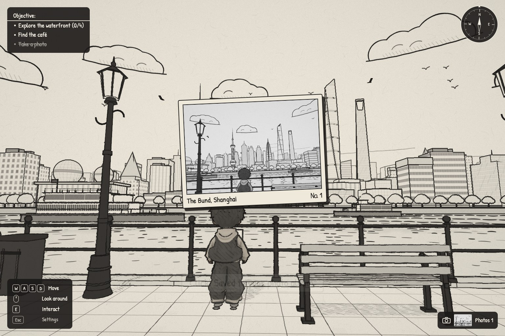</td>
    <td width="33%">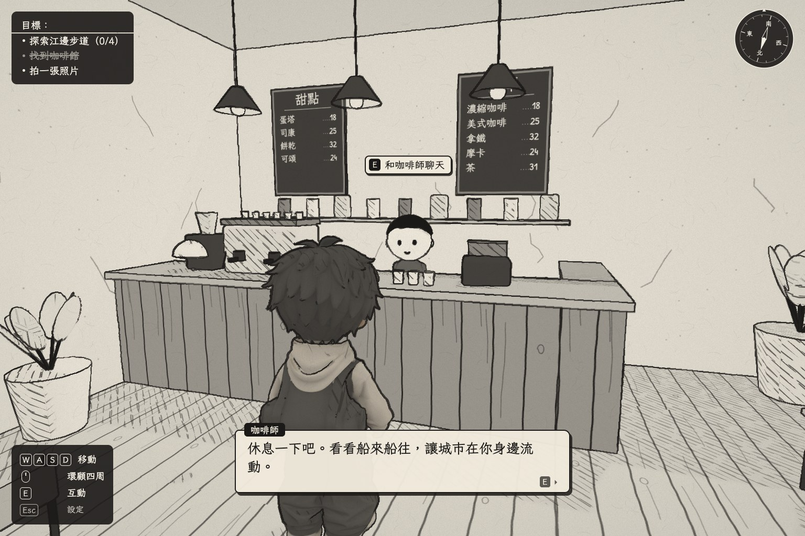</td>
  </tr>
  <tr>
    <td align="center"><sub>Dialogue at Bund Coffee</sub></td>
    <td align="center"><sub>Photos become postcards</sub></td>
    <td align="center"><sub>Fully playable in 中文, menus included</sub></td>
  </tr>
  <tr>
    <td width="33%">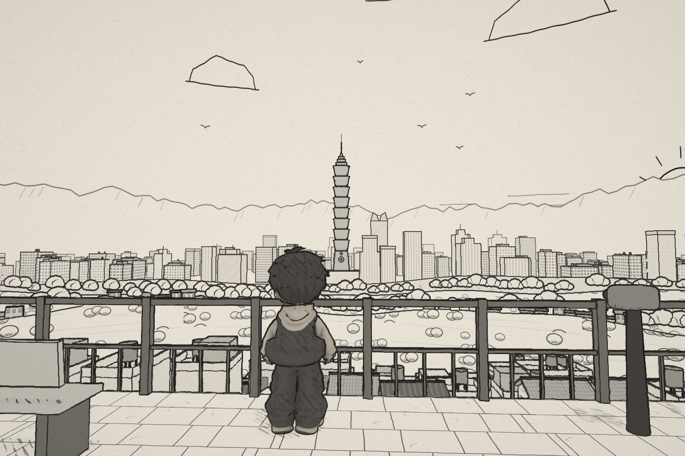</td>
    <td width="33%">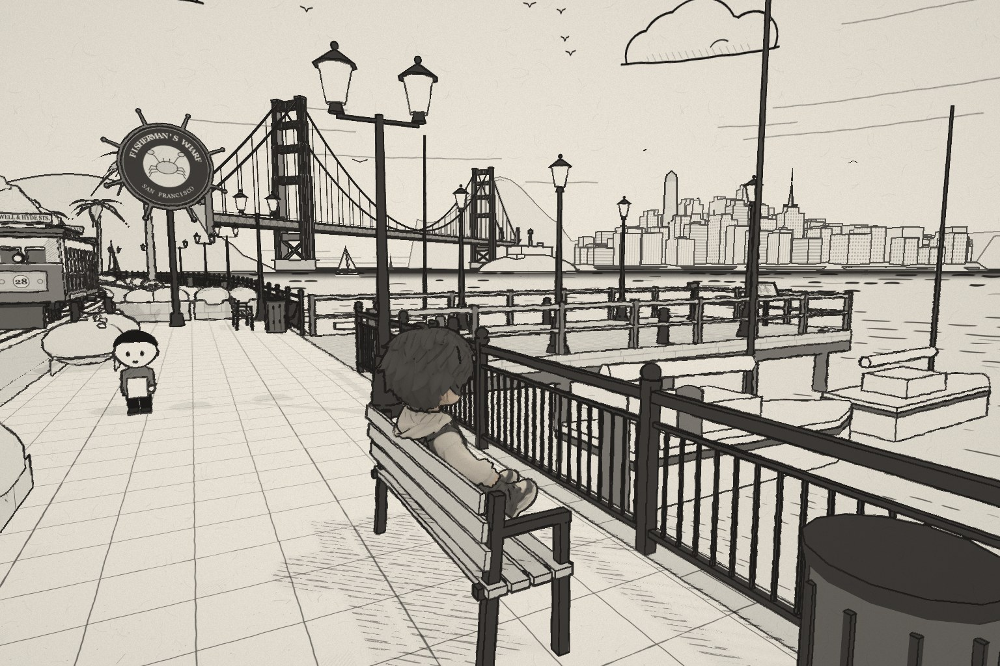</td>
    <td width="33%">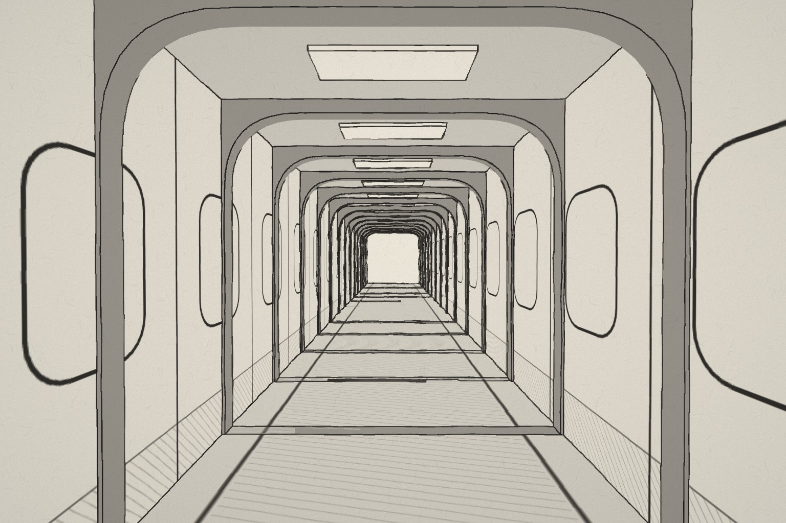</td>
  </tr>
  <tr>
    <td align="center"><sub>Watch the sunset over Taipei</sub></td>
    <td align="center"><sub>Sit and watch the bay</sub></td>
    <td align="center"><sub>Down the jetway to the next city</sub></td>
  </tr>
</table>

## Quick start

You need [Node.js](https://nodejs.org/) 20.19+ or 22.12+ (Vite 8's minimum).

```bash
git clone https://github.com/evch1204/Doodle-Life.git
cd Doodle-Life
npm install
npm run dev
```

Then open **http://localhost:5173**. You start in the loft. To jump straight to a place, add a `scene` parameter:

| URL | Starts in |
| --- | --- |
| `/?scene=lobby` | The airport |
| `/?scene=taiwan` | Jiufen old street |
| `/?scene=shanghai` | The Bund |
| `/?scene=bayarea` | The Embarcadero |

For a production build, run `npm run build`, which writes to `dist/`. To serve that build locally, run `npm run preview`.

## Controls

| Key | Action |
| --- | --- |
| <kbd>W</kbd> <kbd>A</kbd> <kbd>S</kbd> <kbd>D</kbd> or arrow keys | Move; also gets up from a seat |
| Mouse | Look around (click to capture the pointer, or drag) |
| <kbd>E</kbd> | Interact: talk, sit, check in, pick up |
| <kbd>Esc</kbd> | Settings (language, mouse sensitivity); also gets up from a seat or closes the journal |
| <kbd>Tab</kbd> | In the airport, reach the gates as buttons (<kbd>Enter</kbd> checks in) |

During a check-in, <kbd>E</kbd>, <kbd>Esc</kbd>, <kbd>Space</kbd> or <kbd>Enter</kbd> skips the cutscene. With reduced motion turned on, travel becomes a simple fade. In each city, a signpost takes you back to the airport.

## How it's drawn

The ink look is a post-processing pass (`src/ink.js`) on top of a normal three.js render:

1. **Ink surfaces.** Each material is a flat paper tone. Faces turned away from the light, or in shadow, get one layer of hatching; faces that are both get crosshatching. The strokes are anchored in world space, so they don't swim as the camera moves.
2. **Outlines.** Every piece of geometry carries an *outline id*. The post pass draws a line wherever the id changes, wherever the surface normal creases sharply, and wherever the depth jumps. This gives clean contours with no extra geometry and no flicker.
3. **Aerial perspective.** Distant lines and tones fade toward the paper. Landmarks use a reserved *bold* id range, so they stay crisp at any distance.
4. **Paper.** A final pass adds the paper grain and a slight pen wobble.

Scenes are built with a small kit (`src/scenes/kit.js`) that merges geometry into one draw call per material, while each piece keeps its own outline id. The rivers and the bay use a water shader. Its ripple rows are spaced by viewing angle, and the reflections are drawn as pen strokes using the skyline's silhouette.

## Project structure

```
index.html               page shell and HUD markup
src/
├── main.js              entry point
├── game.js              renderer, ink pass, player controller, seats, camera, collision, HUD, travel
├── ink.js               ink material and outline / paper post pass
├── chibi.js             the player: the scanned chibi model, its rig, leg IK, seat poses and follow-through
├── character.js         createCharacter (hands the player to chibi.js) and the NPCs
├── assets/chibi.glb     the player model, built by tools/chibi/prep.py
├── i18n.js              English / 中文 string table
├── sketch.js            wobbly-pen canvas helper used by every texture
├── sound.js             synthesized sound effects
├── style.css            HUD, menus and dialogue styling
├── room.js              the loft: furniture, seats, interactions, stars
├── textures.js          the loft's textures, drawn when the page loads
├── *Textures.js         per-scene textures for the other scenes
└── scenes/
    ├── index.js         scene registry
    ├── kit.js           merged batches, placers, outline ids
    ├── room.js          the loft's scene module (wraps src/room.js)
    ├── lobby.js         the airport and its gates
    ├── taiwan.js        Jiufen   + taiwan/   (hillside town, Taipei 101 and the basin)
    ├── shanghai.js      the Bund + shanghai/ (Bund facades, Pudong, the river shader)
    └── bayarea.js       the Embarcadero + bayarea/ (street kit, cable car, bridge, SF terrain, props)
scripts/                 Playwright playtests, screenshot and performance tools
tools/chibi/prep.py      Blender script: Hunyuan3D scan -> rigged game model
docs/images/             the pictures in this README, shot by scripts/readme_shots.mjs
review/                  the character's source sheets, and screenshots and playtest results from each milestone
```

Each scene module exports its layout: walkable ground (`heightAt`), colliders, interactables, objectives, start position and sun. The shared game in `game.js` handles everything else.

## Adding a city

A new city is one scene module, one line in `src/scenes/index.js`, and a gate in the airport. Gates are the `GATES` array at the top of `src/scenes/lobby.js`. The hall spaces them evenly round the back wall:

```js
{ id: 'tokyo', nameEn: 'Tokyo', nameZh: '東京', icon: 'globe', sceneArt: 'worldmap',
  route: 'tokyo', enabled: true },
```

- `route` is the scene id in `scenes/index.js`. Setting `enabled: false`, or leaving out the route, shows *Coming soon*.
- `icon` is a sign glyph (`ICONS` in `lobbyTextures.js`). `sceneArt` is the view through the arch (`ART` in `lobby.js`).
- Add the prompt (for example `'Check in to Tokyo'`) to `src/i18n.js`, and give the city a signpost home: `act: (ctx) => ctx.travel('lobby')`.

## Testing

The test scripts drive the game in headless Google Chrome through [Playwright](https://playwright.dev/), so Chrome needs to be installed. Start the dev server first. Each script reads the server address from `URL` (default `http://localhost:5173/`).

| Script | What it covers |
| --- | --- |
| `node scripts/playtest.mjs <dir>` | The loft: movement, collision, camera, every interaction |
| `node scripts/playtest_lobby.mjs <dir>` | The airport: every gate, skipping, coming-soon gates, the info desk, keyboard access, reduced motion |
| `node scripts/playtest_taiwan.mjs <dir>` | Jiufen: stairs, railings, camera orbits, objectives, collectibles, the trip there and back |
| `node scripts/playtest_shanghai.mjs <dir>` | The Bund: the river boundary along the whole railing, the café, interactions, animation |
| `node scripts/playtest_bayarea.mjs <dir>` | The Embarcadero: the cable car, the bay and pier boundaries, both ends, the lookout, benches |
| `node scripts/i18n_check.mjs [dir]` | Language switching, a Chinese entry for every reachable string, no text overflow |
| `node scripts/lettering_check.mjs [dir]` | Every sign, menu and poster in each scene follows the language; saves a sheet of them in each language |
| `SCENE=<id> node scripts/perf.mjs` | Frame times, mesh and triangle counts from three gameplay views |
| `node scripts/character-model-check.mjs [dir]` | Player turnaround, walking / sitting / lying shots and rig sanity checks, outside any scene |
| `RECORD_VIDEO=0 node scripts/charreview.mjs <dir>` | Character views in the room plus walking, turning, and Taiwan stairs; omit `RECORD_VIDEO=0` to record video |

These tools make pictures to look over rather than running checks:

| Script | What it makes |
| --- | --- |
| `node scripts/readme_shots.mjs [dir] [names...]` | Every picture in this README (default `docs/images`); run it again when the world or the player changes |
| `node scripts/shots.mjs <dir>` | Review stills (set `SCENE=lobby`, `taiwan`, `shanghai` or `bayarea` for those views) |
| `node scripts/views.mjs <out.png>` | A close turnaround strip of the player |
| `node scripts/charsheet.mjs <out.png>` | A sheet of the player idle and mid-walk from each side |
| `node scripts/stability.mjs <out.png>` | Crops over small camera turns, to spot flickering outlines (also `stability_taiwan.mjs`, `stability_shanghai.mjs`) |
| `node scripts/clip.mjs <dir>` | A recorded tour of the trip to Jiufen and back (also `clip_shanghai.mjs`) |

Some things to know when running them:

- **Video.** `playtest.mjs`, `playtest_taiwan.mjs`, `playtest_shanghai.mjs` and the clip scripts always record video, and `charreview.mjs` does unless told not to. Install Playwright's ffmpeg once first, or they stop at startup:

  ```bash
  npx playwright-core install ffmpeg
  ```

- **macOS.** Most scripts launch Chrome with `--use-angle=d3d11`, which uses the GPU on Windows. On macOS it renders on the CPU instead and the walking checks time out, so change that flag to `--use-angle=metal` in the script you're running. `charreview.mjs`, `lettering_check.mjs` and `readme_shots.mjs` already pick the right one.
- **Slow machines.** `TIMEOUT_SCALE=3` stretches the walking timeouts.
- **Known false alarms.** A few checks can fail with nothing wrong in the game:
  - Airport, "the list shows while focused": it reads the gate list during its 0.2 s fade-in.
  - Embarcadero, "the cable car runs along its stretch of track": it watches for 5 s, and the car pauses for 12 s at each end of its run.
  - Jiufen, "room still works after the trip": it allows 2.6 s, and sitting down at the desk now takes longer.
  - Bund, "camera orbit (inside the café)": it counts the camera as inside the counter when it is only above it.
- **Frame rate.** The Jiufen playtest requires at least 45 fps while walking, which depends on the machine.

Screenshots and playtest results from every milestone are kept in [`review/`](review/). They're a record of how the project got here, so the older ones show earlier versions of the world and the player.
